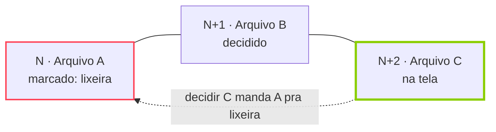

<p align="center">
  
</p>

<p align="center">
  
  
  
  
</p>

<p align="center">
  <b>Faxina na galeria no estilo Tinder.</b><br>
  Escolha uma pasta, e cada foto, vídeo ou GIF vira um card: direita mantém, esquerda manda pra lixeira.
</p>

---

## Como funciona

O app monta a fila da pasta **do arquivo mais antigo para o mais novo** e mostra um card por vez.

| Gesto | Botão | O que acontece |
| :-- | :-: | :-- |
| ⟶ arrastar para a direita | ♥ | **mantém** o arquivo |
| ⟵ arrastar para a esquerda | ✕ | marca para **mandar pra lixeira** |
| ↑ arrastar para cima | ★ | **favorita** (mantém e marca como favorito no Android) |
| — | ↺ | **rebobina** um card e desfaz a decisão |
| tocar no card | — | abre em **tela cheia** (zoom, vídeo com som) |

### A regra dos 2 arquivos

Nada some na hora. Um arquivo marcado para a lixeira espera num buffer até você decidir **mais dois arquivos**. Até lá, rebobinar desfaz tudo, e o arquivo nunca sai do lugar.



E mesmo depois disso, o arquivo vai para a **lixeira do Android**, não é apagado de vez: ele fica lá por 30 dias e pode ser restaurado pela galeria do aparelho.

## Destaques

- **UI do Tinder em verde brat**: pilha de cards, carimbos MANTÉM / APAGA / FAVORITA, botões que acendem conforme o arraste.
- **Fotos, GIFs animados e vídeos** tocando em loop dentro do card.
- **Progresso salvo por pasta**: feche o app no meio e volte no mesmo card, com o buffer intacto.
- **Cada subpasta é uma pasta separada** na lista, com a barra de progresso da revisão.
- **Sem confirmação a cada arquivo**: com a permissão *Gerenciamento de mídia*, o Android não pergunta nada.
- **100% offline**: o app nem pede permissão de internet.

## Permissões

| Permissão | Para quê | Obrigatória |
| :-- | :-- | :-: |
| Fotos e vídeos (`READ_MEDIA_IMAGES`, `READ_MEDIA_VIDEO`) | montar a fila de cada pasta | sim |
| Gerenciamento de mídia (`MANAGE_MEDIA`) | mandar pra lixeira e favoritar sem diálogo do sistema | recomendada |

Sem a segunda, o app funciona, mas o Android pede confirmação a cada envio para a lixeira.

## Compilando

Requisitos: **JDK 17+** e o **Android SDK** com a plataforma 37.

```bash
git clone https://github.com/murandido/exinder.git
cd exinder
./gradlew assembleDebug
```

O APK sai em `app/build/outputs/apk/debug/app-debug.apk`. Para instalar direto num celular com depuração USB ligada:

```bash
./gradlew installDebug
```

## Por dentro

| Camada | Tecnologia |
| :-- | :-- |
| UI | Kotlin, Jetpack Compose, Material 3 |
| Pastas, lixeira e favoritos | `MediaStore` (`createTrashRequest`, `createFavoriteRequest`) |
| Imagens e GIFs | Coil 3 |
| Vídeo | Media3 ExoPlayer |
| Decisões salvas | Room |
| Preferências | DataStore |

```
app/src/main/java/app/exinder/
├── ExinderApp.kt            # Application, dependências e configuração do Coil
├── MainActivity.kt          # Activity única e navegação entre telas
├── data/
│   ├── Models.kt            # pasta, arquivo e status de decisão
│   ├── MediaRepository.kt   # leitura do MediaStore, lixeira e favoritos
│   ├── Database.kt          # Room: decisões gravadas a cada swipe
│   ├── Prefs.kt             # DataStore: última pasta aberta
│   └── SystemRequests.kt    # ponte para os pedidos do sistema
├── ui/
│   ├── theme/               # paleta verde brat e logo
│   ├── permissions/         # tela de permissões
│   ├── folders/             # lista de pastas com progresso
│   ├── swipe/               # pilha de cards, gestos e regra dos 2 arquivos
│   └── viewer/              # player de vídeo e tela cheia
└── util/Format.kt           # datas, tamanhos e números em pt-BR
```

O documento de requisitos completo está em [`docs/REQUISITOS.md`](docs/REQUISITOS.md).

## Commits

O histórico segue [Conventional Commits](https://www.conventionalcommits.org/pt-br/), um commit por mudança:

| Prefixo | Uso |
| :-- | :-- |
| `feat:` | funcionalidade nova |
| `fix:` | correção de bug |
| `hotfix:` | correção urgente em algo já publicado |
| `refactor:` | mudança de código sem mudar comportamento |
| `style:` | formatação, sem mudança de lógica |
| `docs:` | documentação |
| `chore:` | build, dependências, configuração |

## Licença

[MIT](LICENSE). *exinder* é um projeto pessoal, sem relação com o Tinder ou com a Match Group.
