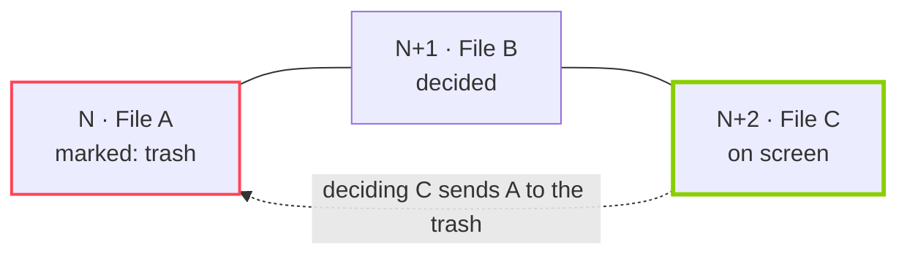

<p align="center">
  
</p>

<p align="center">
  <a href="https://github.com/murandido/exinder/actions/workflows/ci.yml"></a>
  
  
  
  <a href="LICENSE"></a>
</p>

<p align="center">
  <b>Clean up your gallery, one swipe at a time.</b><br>
  Pick a folder and every photo, video or GIF becomes a card: swipe right to keep it, left to send it to the trash.
</p>

---

> [!CAUTION]
> **This code was written by an AI (Claude) and has not been reviewed by a human.**
>
> exinder moves your files to the Android trash. A bug can send the wrong file there, and the system trash empties itself after about 30 days, after which the file is gone for good. Read [Risks](#risks) before using it on photos you care about.

## How it works

The app builds a queue of the folder's files **from oldest to newest** and shows one card at a time.

| Gesture | Button | What happens |
| :-- | :-: | :-- |
| ⟶ swipe right | ♥ | **keep** the file |
| ⟵ swipe left | ✕ | mark it for the **trash** |
| ↑ swipe up | ★ | **favorite** it (keep, and mark it as a favorite in Android) |
| — | ↺ | **rewind** one card and undo the decision |
| tap the card | — | open it **full screen** (zoom, video with sound; drag down to close) |

### The 2-file rule

Nothing disappears right away. A file marked for the trash waits in a queue until you decide **two more files**. Until then, rewinding undoes it and the file never moves.



Even then, the file goes to the **Android trash**, not straight to deletion: it stays there for about 30 days and can be restored from the device's gallery. exinder never deletes anything permanently.

## Features

- **Card stack UI in *brat* green:** KEEP / DELETE / FAVORITE stamps, buttons that light up as you drag, a vibration when you cross the threshold and when a file actually goes to the trash.
- **Photos, animated GIFs, SVGs and videos**, with videos looping muted inside the card.
- **Preloading:** the next card's video player is already prepared, and the card after that is decoded ahead of time.
- **Rewind shows what's gone:** files already sent to the trash pass by as grey "in the trash" cards.
- **Full screen** with pinch to zoom; drag down to close.
- **Progress saved per folder:** close the app midway and come back to the same card, with the trash queue intact.
- **Each subfolder is its own folder** in the list, with a review progress bar.
- **No confirmation for every file:** with the *Media management* permission, Android doesn't ask each time.
- **Light, dark or system theme**, picked from the menu.
- **English and Brazilian Portuguese.**
- **Fully offline:** the app doesn't even request network access.

## Risks

Please read this before pointing exinder at photos you care about.

- **No human code review.** Every line was written by an AI. A separate set of AI agents reviewed it twice and the bugs they found were fixed, but that is not a substitute for a careful human review.
- **It moves real files to the trash.** A logic bug could send a file you didn't swipe left on to the trash, or send it without the 2-file grace. Files in the system trash are deleted permanently after about 30 days.
- **With *Media management* on, nothing asks first.** That permission lets the app trash files without a system dialog. If you want a second chance on every file, skip it: Android will then confirm each one.
- **Barely tested.** It has been used on a single phone (Samsung Galaxy S25 Ultra, Android 17). Other manufacturers handle the trash, SD cards and permissions differently.
- **No warranty.** It is MIT-licensed and provided "as is".

**If you use it anyway:**

1. Back up the folder first (cloud backup or a copy on a computer).
2. Try it on a throwaway folder before a real one.
3. Consider leaving *Media management* off at first, so Android confirms every file.
4. Check the gallery's trash from time to time, and restore anything that shouldn't be there before it expires.

## Permissions

| Permission | Why | Required |
| :-- | :-- | :-: |
| Photos and videos (`READ_MEDIA_IMAGES`, `READ_MEDIA_VIDEO`; `READ_EXTERNAL_STORAGE` on Android 12) | build each folder's queue | yes, full access |
| Media management (`MANAGE_MEDIA`) | send to the trash and favorite without a system dialog | recommended |

Android 14+'s "limited access" (picking a few photos) isn't enough: the app needs to see the whole folder, and says so when that's the case. Without the second permission the app still works, but Android asks for confirmation every time something goes to the trash.

## Installing

There is no Play Store release. Build it from source:

**Requirements:** JDK 17 or newer and the Android SDK with platform 37.

```bash
git clone https://github.com/murandido/exinder.git
cd exinder
./gradlew assembleDebug
```

The APK ends up in `app/build/outputs/apk/debug/app-debug.apk`. To install it straight onto a phone with USB debugging on:

```bash
./gradlew installDebug
```

Every CI run on `main` also uploads the debug APK as a build artifact.

### Language

The app follows the system language: English, or Brazilian Portuguese on a phone set to Portuguese. On Android 13+ you can pick the app's language on its own in *Settings → Apps → exinder → Language*.

## Under the hood

| Layer | Technology |
| :-- | :-- |
| UI | Kotlin, Jetpack Compose, Material 3 |
| Folders, trash and favorites | `MediaStore` (`createTrashRequest`, `createFavoriteRequest`) |
| Images, GIFs and SVGs | Coil 3 |
| Video | Media3 ExoPlayer |
| Saved decisions | Room |
| Preferences | DataStore |

```
app/src/main/java/app/exinder/
├── ExinderApp.kt            # Application, dependencies and Coil setup
├── MainActivity.kt          # single Activity and navigation between screens
├── data/
│   ├── Models.kt            # folder, file and decision status
│   ├── MediaRepository.kt   # MediaStore queries, trash and favorites
│   ├── Database.kt          # Room: decisions saved on every swipe
│   ├── Prefs.kt             # DataStore: last folder, theme
│   └── SystemRequests.kt    # bridge to system confirmation dialogs
├── ui/
│   ├── theme/               # brat green palette and logo
│   ├── permissions/         # permissions screen
│   ├── folders/             # folder list with progress
│   ├── swipe/               # card stack, gestures and the 2-file rule
│   └── viewer/              # video player and full screen viewer
└── util/Format.kt           # dates, sizes and numbers
```

The original requirements document is in [`docs/REQUIREMENTS.md`](docs/REQUIREMENTS.md).

## Quality gates

Every push and pull request runs the [CI workflow](.github/workflows/ci.yml):

| Gate | What it checks |
| :-- | :-- |
| **Build** | `assembleDebug` and `assembleRelease` compile |
| **Unit tests** | the trash queue rules, rewind and formatting (`./gradlew testDebugUnitTest`) |
| **Android Lint** | `./gradlew lintDebug`, failing on errors and on any new warning not in the baseline |
| **ktlint** | Kotlin style, following [`.editorconfig`](.editorconfig) |
| **Conventional Commits** | pull request commit messages follow the convention below |

Dependabot keeps Gradle dependencies and GitHub Actions up to date. To run the same checks locally:

```bash
./gradlew ktlintCheck testDebugUnitTest lintDebug assembleDebug
```

## Contributing

Issues and pull requests are welcome. See [CONTRIBUTING.md](CONTRIBUTING.md). Commits follow [Conventional Commits](https://www.conventionalcommits.org/), one change per commit:

| Prefix | Use |
| :-- | :-- |
| `feat:` | new feature |
| `fix:` | bug fix |
| `hotfix:` | urgent fix to something already released |
| `refactor:` | code change with no behavior change |
| `style:` | formatting only |
| `test:` | tests |
| `docs:` | documentation |
| `ci:` | CI and quality gates |
| `chore:` | build, dependencies, configuration |

The early history of the repository is in Portuguese; everything from the English translation onward is in English.

## License

exinder is free and open source software under the [MIT License](LICENSE). That covers everything in this repository: the code, the docs and the images.

In plain words, you can:

- use it, for personal or commercial purposes;
- copy, modify and fork it;
- redistribute it, original or modified, including inside closed-source products.

The only condition is to keep the copyright notice and the license text with any copy. It comes with no warranty (see [Risks](#risks)).

*exinder* is a personal project with no affiliation with Tinder or Match Group.
