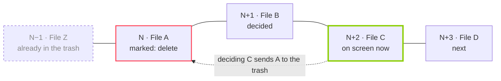

# exinder — Requirements

> This is the document that guided the first version of the app, translated from the original Portuguese. It is kept as a historical record. Where the app ended up behaving differently, the difference is noted in [Changes since this document](#changes-since-this-document). The decisions made while writing it are listed under [Decisions](#decisions).

## Overview

exinder is a native Android app, written in Kotlin, for cleaning up a media folder Tinder-style: every photo, video or GIF becomes a card, and the user swipes right to keep it or left to delete it.

- **Problem:** folders like DCIM, WhatsApp or Downloads pile up thousands of files, and deleting them through the gallery is slow and tiring.
- **Proposal:** review a folder in chronological order, oldest file first, with one decision per gesture.
- **Safety:** nothing is deleted right away. A file marked for deletion only goes to the Android trash after the user moves 2 more files ahead, and until then it can be rewound.
- **Platform:** Android only. No iOS, no backend, no account. Everything stays on the device.
- **Look:** a Tinder-style card UI, with the pink/red brand color swapped for *brat* green.
- **User:** personal use, one person per device. Distributed as an APK (sideload), not through the Play Store.

## Main flow and the deletion rule

The user picks a folder, the app builds a queue from oldest to newest and shows one card at a time. Each file marked for deletion waits in a 2-position buffer before it is actually removed.

### Flow

1. The user opens the app and picks a folder on the device.
2. The app lists only the files in that folder (subfolders are separate folders) and keeps photos, videos and GIFs.
3. Files are sorted by date, oldest first.
4. The app shows the first file not yet reviewed.
5. The user decides: right = keep, left = delete.
6. The next card comes up. Repeat until the end of the queue.
7. At the end, the app shows a summary: how many kept, how many deleted, space freed.

### The 2-file rule (delayed deletion)

A file at position **N** marked for deletion is only really deleted when the user decides file **N+2**.

| Moment | File A (position N) | What the user can do |
| --- | --- | --- |
| Swipe left on A | Marked for deletion, still exists | Rewind and undo |
| Decide file B (N+1) | Still exists | Rewind twice and undo |
| Decide file C (N+2) | Goes to the Android trash | Only recoverable from the system trash (30 days) |

- The buffer holds at most 2 pending "delete" decisions at a time; "keep" decisions are not queued.
- The count is by position, not by number of deletions: moving 2 cards ahead, keep or delete, commits the deletion.



While A and B are in the buffer, rewinding still saves A; the decision on C is what sends A to the trash.

### Rewind

- The rewind button goes back 1 card per tap and reopens that file's decision.
- Rewinding over a file pending deletion cancels the deletion; it becomes "undecided" again.
- The buffer counter follows the cursor: if the user goes back from N+1 to N, N is only deleted again once they reach N+2 again.
- The user can rewind past the buffer over kept files (they are still on the device and can become "delete").
- Files already in the trash show up on the way back as a grey "in the trash" card with no actions, and rewind skips over them.

## Functional requirements

| ID | Requirement | Priority |
| --- | --- | --- |
| FR01 | Pick a folder from a list of every folder with media on the device (each subfolder is a separate item) and remember it between launches | High |
| FR02 | List the folder's photos (JPG, PNG, HEIC, WEBP), videos (MP4, MKV, WEBM, 3GP) and GIFs, without descending into subfolders; ignore everything else | High |
| FR03 | Sort oldest to newest by capture date (EXIF / video metadata); without it, use the modification date | High |
| FR04 | Show one file per card: full photo, animated GIF, video playing muted and looping | High |
| FR05 | Swipe right or heart button = keep | High |
| FR06 | Swipe left or X button = mark for deletion | High |
| FR07 | Send file N to the Android trash when file N+2 is decided (2-file rule); the app never deletes permanently | High |
| FR08 | Rewind button goes back 1 card per tap and undoes deletions that are still pending | High |
| FR09 | Save progress per folder: when reopened, continue from the first undecided file | High |
| FR10 | Do not show files already marked "keep" again in future sessions, unless the user resets the folder | Medium |
| FR11 | Tapping the card opens the file full screen (zoom on photos, controls and sound on videos) | Medium |
| FR12 | Show file name, date and size on the card, like Tinder's "name, age" | Medium |
| FR13 | Counter at the top: current position / total, and space freed so far | Medium |
| FR14 | Summary screen at the end of the queue: kept, favorited, sent to the trash, MB freed | Medium |
| FR15 | Leaving the app with deletions pending in the buffer keeps them pending; they come back as pending next time | Medium |
| FR18 | Swipe up or star button = favorite: keeps the file and marks it as a favorite in Android | Medium |
| FR16 | "Reset folder" button that clears that folder's decision history (does not touch the files) | Low |
| FR17 | Short vibration when crossing the swipe threshold and when a file is sent to the trash | Low |

## UI and UX

The main screen follows Tinder's layout: a stack of cards filling most of the screen, a logo bar at the top and a row of round buttons at the bottom. The brand color replaces Tinder's pink/orange gradient with *brat* green.

### Palette

| Token | Color | Use |
| --- | --- | --- |
| `brat` | `#8ACE00` | Brand color: logo, keep button, KEEP stamp, gradient |
| `bratLight` | `#B9F227` | Light end of the brand gradient |
| `ink` | `#000000` | Text on green, dark mode background |
| `surface` | `#FFFFFF` (light) / `#111111` (dark) | Screen background |
| `nope` | `#FF4458` | X button and DELETE stamp (the familiar red, read instantly) |
| `star` | `#2DB3FF` | Star button and FAVORITE stamp (the familiar "super like" blue) |
| `rewind` | `#F5B748` | Rewind button (the familiar yellow) |

Logo: "exinder" in lowercase, Arial Narrow (or similar), black on green, in the style of the *brat* album cover.

### Swipe screen (main)

- **Top:** "exinder" logo on the left; on the right, the folder name and a settings icon. Below, a counter "1,234 / 5,678" and "2.3 GB freed".
- **Card:** 8 dp rounded corners, media filling the whole card (`ContentScale.Crop`), dark gradient at the bottom with:
  - line 1, large and bold: the date as "14 Mar 2019" (the "name, age" equivalent);
  - line 2: file name, size, and duration for videos;
  - a type icon (photo, video, GIF) in the corner.
- **Stack:** the next card sits behind, slightly smaller, and grows as the top one leaves.
- **Stamps:** dragging right reveals a rotated green "KEEP" in the top-left corner; left, a red "DELETE" in the top-right; up, a blue "FAVORITE" at the bottom of the card. Opacity follows the drag distance.
- **Bottom buttons** (white circles with a shadow and a colored icon):
  1. Rewind (yellow, small)
  2. X delete (red, large)
  3. Star favorite (blue, small)
  4. Heart keep (*brat* green, large)
- **Trash queue:** above the buttons, up to 2 round thumbnails of the pending files, labelled "trash in 2" / "trash in 1". Tapping one rewinds to it.

### Gestures

- Drag the card with a finger; it rotates up to ~15° with the horizontal offset.
- Releasing past 30% of the screen width, or with high velocity, confirms the decision and the card flies out.
- Dragging up past 20% of the screen height favorites the file.
- Releasing before that springs the card back to the center.
- Tapping the card opens it full screen; dragging down in full screen closes it.

### Other screens

| Screen | Content |
| --- | --- |
| Pick a folder | List of every folder with media on the device, each subfolder as a separate item, with its file count and progress |
| Full screen | Photo with pinch to zoom, animated GIF, video with sound and a progress bar; full metadata at the bottom |
| Summary | End of the queue: big numbers for kept, deleted and space freed, "pick another folder" button |
| Settings | Change folder, reset folder, light/dark theme |

## Non-functional requirements

The critical point is sending files to the trash without Android asking for confirmation on every file. The special "Media management" permission solves that; the app asks for it once, on first launch.

| ID | Requirement |
| --- | --- |
| NFR01 | Android 12 (API 31) or newer, required by the media management permission; target the latest stable API |
| NFR02 | Send to the trash without a per-file system dialog: special permission "Media management" (MANAGE\_MEDIA), granted once in system settings |
| NFR03 | Swiping runs at 60 fps or more, without stutter on large photos (12 MP+) |
| NFR04 | The next 2 cards are preloaded; the next video already has its player prepared |
| NFR05 | A folder with 10,000 files shows the first screen within 3 s; the rest of the scan continues in the background |
| NFR06 | Sending to the trash runs off the UI thread and never blocks the next swipe |
| NFR07 | If a deletion fails (file gone, no permission), the app shows a toast and moves on |
| NFR08 | Decision state is saved on every swipe; killing the app midway loses nothing and does not delete what was pending |
| NFR09 | No network access: no `INTERNET` permission, no analytics |
| NFR10 | No onboarding or tutorial: after permissions, open straight to the folder list |

## Suggested architecture

A single module, Jetpack Compose and simple MVVM. No backend.

| Layer | Choice | Why |
| --- | --- | --- |
| Language / UI | Kotlin + Jetpack Compose (Material 3) | Native; drag animations are easy with `Modifier.pointerInput` and `Animatable` |
| Folders and files | MediaStore (`MediaStore.Files`, grouped by `RELATIVE_PATH`) with `READ_MEDIA_IMAGES` and `READ_MEDIA_VIDEO` | Lists every folder with media, each subfolder as its own item, without the system picker |
| Trash | `MediaStore.createTrashRequest` + special permission `MANAGE_MEDIA` | Sends to the system trash (30 days); with the permission, the `PendingIntent` returns without a dialog |
| Favorite | `MediaStore.createFavoriteRequest` | The star button sets `IS_FAVORITE`, also without a dialog |
| Dates | MediaStore `DATE_TAKEN`; otherwise `ExifInterface` (photos) or `MediaMetadataRetriever` (videos); last resort `DATE_MODIFIED` | Real capture order |
| Images and GIFs | Coil 3 (`coil-gif`, `coil-video` for thumbnails) | Caching and decoding off the UI thread |
| Video | Media3 ExoPlayer | Muted loop on the card, controls in full screen |
| State | Room: `decision` table (folder, uri, date, status, position) | Per-folder progress that survives the app being killed |
| Preferences | DataStore | Current folder, theme |
| Concurrency | Coroutines + Flow; trash requests in an application `CoroutineScope` | Survives screen changes |
| DI | None, or manual injection | Small app; Hilt would be extra weight |

### Swipe state model

The status names are the ones used in the code (Portuguese): `MANTER` = keep, `FAVORITO` = favorite, `LIXEIRA_PENDENTE` = pending trash, `NA_LIXEIRA` = in the trash.

```kotlin
enum class Status { PENDENTE, MANTER, FAVORITO, LIXEIRA_PENDENTE, NA_LIXEIRA }

data class Item(val uri: Uri, val takenAt: Long, val size: Long, val mime: String, var status: Status)

class SwipeState(
    val items: List<Item>,   // sorted oldest to newest
    var cursor: Int,         // card on screen
)

// when the item at the cursor is decided:
//   status = MANTER, FAVORITO or LIXEIRA_PENDENTE
//   cursor++
//   val target = cursor - 3          // the item decided 2 positions before the current one
//   if (target >= 0 && items[target].status == LIXEIRA_PENDENTE) sendToTrash(target) -> NA_LIXEIRA
//
// on rewind:
//   cursor-- (skipping NA_LIXEIRA)
//   item status = PENDENTE
```

Formal rule: when the user decides item `N+2`, item `N` goes to the trash if it is `LIXEIRA_PENDENTE`.

## Edge cases

| Situation | Behavior |
| --- | --- |
| End of the queue with 1 or 2 deletions pending | The summary shows "2 files will go to the trash" with "send now" and "back" buttons; nothing goes to the trash without that confirmation |
| App closed with pending deletions | They stay pending (FR15); when reopened, the user is back on the same card |
| File deleted or moved outside the app | Drops out of the queue on the next scan; if it was in the buffer, it is discarded silently |
| New file in the folder | Joins the queue at its date's position; if it is older than the cursor, it appears at the end as "new" |
| Two files with the same date | Tie broken by file name |
| Corrupt video or image | Card with an error icon and the file name; keep and delete work as usual |
| Media or media management permission revoked | Ask for the permission again before the next swipe |
| Empty folder or no media | "Nothing to review here" message |

## Acceptance criteria

- [ ] I pick a folder and the first card is its oldest file.
- [ ] Subfolders show up as separate folders in the list, and their files are not part of the parent folder's queue.
- [ ] I swipe left and the file stays where it is until I decide 2 more files.
- [ ] After deciding the second following file, the file is in the Android trash, not permanently deleted.
- [ ] I mark a file for deletion, rewind, and it comes back without ever having gone to the trash.
- [ ] No system dialog appears when sending to the trash or favoriting.
- [ ] I swipe up or tap the star and the file becomes a favorite in Android.
- [ ] I close the app midway, reopen it and continue from the same card, with pending deletions intact.
- [ ] GIFs animate and videos loop inside the card.
- [ ] The UI is recognizably Tinder-style, in *brat* green.

## Out of scope

- iOS, web version, cloud sync, user accounts.
- Detecting duplicate or similar photos.
- Moving files to another folder (keep or delete only).
- Play Store release, translations, accessibility beyond the basics.

## Decisions

- **Deletion:** nothing is deleted permanently; the file goes to the Android trash and disappears on its own after 30 days.
- **Order:** capture date; without it, modification date.
- **Subfolders:** each subfolder is a separate folder in the list; reviewing a folder does not include its subfolders.
- **Star:** favorite, i.e. keep and mark as a favorite in Android; swiping up does the same.
- **In-app trash:** no dedicated screen; the device gallery already shows the system trash and restores from there.

## Changes since this document

- **File types (FR02):** the app accepts every image and video MediaStore indexes, not only the listed formats. SVG files are also shown, rendered on a white background.
- **Trash grace (FR07):** the 2-file grace is counted in decisions made after the file, not in positions. Rewinding over files already in the trash would otherwise give a newly marked file no grace at all.
- **Grey "in the trash" cards:** only shown for files trashed in the current session. After the app restarts, trashed files are no longer readable, so they are skipped silently.
- **Background scan (NFR05):** the folder is scanned in one pass before the first card is shown; there is no incremental loading.
- **Full screen metadata:** shown at the top, away from the video controls.
- **Translations:** the UI is in English, with a Brazilian Portuguese translation.
- **Favorites:** rewinding a favorite only removes the favorite if the app set it; files that were already favorites keep it.
