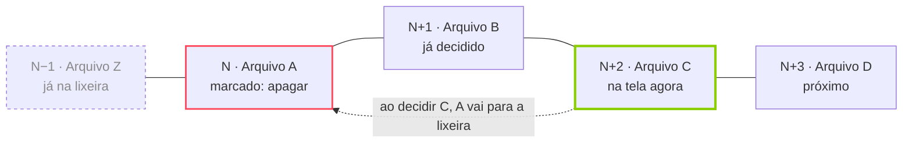

# exinder — Documento de Requisitos

> Documento que guiou a primeira versão do app. As decisões tomadas durante a escrita estão na seção [Decisões](#decisões).

## Visão geral

Exinder é um app Android nativo, em Kotlin, que faz a faxina de uma pasta de mídia no estilo Tinder: cada foto, vídeo ou GIF vira um card, e o usuário arrasta para a direita para manter ou para a esquerda para apagar.

- **Problema:** pastas como DCIM, WhatsApp ou Downloads acumulam milhares de arquivos, e apagar pela galeria é lento e cansativo.
- **Proposta:** revisar a pasta em ordem cronológica, do arquivo mais antigo para o mais novo, com uma decisão por gesto.
- **Diferencial de segurança:** nada é apagado na hora. Um arquivo marcado para apagar só vai para a lixeira do Android depois que o usuário avança mais 2 arquivos, e até lá dá para rebobinar e mudar de ideia.
- **Plataforma:** só Android. Sem iOS, sem backend, sem conta, tudo local no aparelho.
- **Visual:** cópia direta da UI do Tinder, trocando o vermelho/rosa pelo verde brat.
- **Usuário:** uso pessoal, uma pessoa por aparelho. Distribuição inicial por APK (sideload), não pela Play Store.

## Fluxo principal e regra de exclusão

O usuário escolhe uma pasta, o app monta a fila do mais antigo para o mais novo e mostra um card por vez. Cada arquivo marcado para apagar fica num buffer de 2 posições antes de ser removido de fato.

### Fluxo

1. Usuário abre o app e escolhe uma pasta do aparelho.
2. O app lista só os arquivos da própria pasta (subpastas aparecem como pastas separadas) e filtra fotos, vídeos e GIFs.
3. Os arquivos são ordenados por data, do mais antigo para o mais novo.
4. O app mostra o primeiro arquivo ainda não revisado.
5. O usuário decide: direita = manter, esquerda = apagar.
6. O próximo card sobe. Repete até o fim da fila.
7. No fim, o app mostra um resumo: quantos mantidos, quantos apagados, espaço liberado.

### Regra dos 2 arquivos (exclusão adiada)

Um arquivo na posição **N** marcado para apagar só é apagado de verdade quando o usuário decide o arquivo **N+2**.

| Momento | Arquivo A (posição N) | O que o usuário pode fazer |
| --- | --- | --- |
| Swipe esquerda em A | Marcado para apagar, ainda existe | Rebobinar e desfazer |
| Decide o arquivo B (N+1) | Ainda existe | Rebobinar 2 vezes e desfazer |
| Decide o arquivo C (N+2) | Vai para a lixeira do Android | Só volta pela lixeira do sistema (30 dias) |

- O buffer guarda no máximo 2 decisões de "apagar" pendentes ao mesmo tempo; decisões de "manter" não entram em fila.
- A contagem vale por posição, não por quantidade de apagados: avançar 2 cards, sejam manter ou apagar, efetiva a exclusão.



Enquanto A e B estão no buffer, rebobinar ainda salva A; a decisão sobre C é o que manda A para a lixeira.

### Rebobinar

- O botão de rebobinar volta 1 card por toque e reabre a decisão daquele arquivo.
- Voltar sobre um arquivo pendente de exclusão cancela a exclusão; ele volta a ser "não decidido".
- Ao voltar, o contador do buffer anda junto: se o usuário volta de N+1 para N, a exclusão de N só acontece de novo quando ele chegar outra vez em N+2.
- O usuário pode rebobinar além do buffer sobre arquivos mantidos (eles continuam no aparelho e podem virar "apagar").
- Arquivos já na lixeira aparecem na volta como um card cinza "na lixeira", sem ação, e o rebobinar pula por cima deles.

## Requisitos funcionais

| ID | Requisito | Prioridade |
| --- | --- | --- |
| RF01 | Escolher uma pasta numa lista de todas as pastas com mídia do aparelho (cada subpasta é um item separado) e lembrar dela entre aberturas do app | Alta |
| RF02 | Listar fotos (JPG, PNG, HEIC, WEBP), vídeos (MP4, MKV, WEBM, 3GP) e GIFs da pasta, sem entrar nas subpastas; ignorar o resto | Alta |
| RF03 | Ordenar do mais antigo para o mais novo pela data de captura (EXIF / metadado do vídeo); sem essa data, usar a data de modificação | Alta |
| RF04 | Mostrar um arquivo por card: foto inteira, GIF animado, vídeo tocando sem som e em loop | Alta |
| RF05 | Swipe direita ou botão coração = manter | Alta |
| RF06 | Swipe esquerda ou botão X = marcar para apagar | Alta |
| RF07 | Mandar o arquivo N para a lixeira do Android quando o arquivo N+2 for decidido (regra dos 2 arquivos); nada é apagado de vez pelo app | Alta |
| RF08 | Botão rebobinar volta 1 card por toque e desfaz exclusões ainda pendentes | Alta |
| RF09 | Salvar o progresso por pasta: ao reabrir, continuar do primeiro arquivo não decidido | Alta |
| RF10 | Não mostrar de novo arquivos já marcados como "manter" em sessões futuras, exceto se o usuário resetar a pasta | Média |
| RF11 | Tocar no card abre o arquivo em tela cheia (zoom em fotos, controles e som no vídeo) | Média |
| RF12 | Mostrar no card nome do arquivo, data e tamanho, como o "nome, idade" do Tinder | Média |
| RF13 | Contador no topo: posição atual / total e espaço já liberado | Média |
| RF14 | Tela de resumo ao terminar a fila: mantidos, favoritados, enviados para a lixeira, MB liberados | Média |
| RF15 | Ao sair do app com exclusões pendentes no buffer, elas continuam pendentes e voltam como pendentes na próxima abertura | Média |
| RF18 | Swipe para cima ou botão estrela = favoritar: mantém o arquivo e marca como favorito no Android | Média |
| RF16 | Botão "resetar pasta" que apaga o histórico de decisões daquela pasta (não mexe nos arquivos) | Baixa |
| RF17 | Vibração curta ao cruzar o limiar do swipe e ao mandar um arquivo para a lixeira | Baixa |

## UI e UX

A tela principal copia o layout do Tinder: pilha de cards ocupando quase a tela toda, barra de logo no topo e uma fileira de botões redondos embaixo. A cor da marca troca o gradiente rosa/laranja do Tinder pelo verde brat.

### Paleta

| Token | Cor | Uso |
| --- | --- | --- |
| `brat` | `#8ACE00` | Cor da marca: logo, botão manter, carimbo MANTÉM, gradiente |
| `bratLight` | `#B9F227` | Ponta clara do gradiente da marca |
| `ink` | `#000000` | Texto sobre o verde, fundo do modo escuro |
| `surface` | `#FFFFFF` (claro) / `#111111` (escuro) | Fundo das telas |
| `nope` | `#FF4458` | Botão X e carimbo APAGA (mesmo vermelho do Tinder, pra leitura imediata) |
| `star` | `#2DB3FF` | Botão estrela e carimbo FAVORITA (azul do superlike do Tinder) |
| `rewind` | `#F5B748` | Botão rebobinar (mesmo amarelo do Tinder) |

Logo: "exinder" em minúsculas, Arial Narrow (ou similar), preto sobre o verde, no estilo da capa do *brat*.

### Tela de swipe (principal)

- **Topo:** logo "exinder" à esquerda; à direita, o nome da pasta e o ícone de ajustes. Abaixo, contador "1.234 / 5.678" e "2,3 GB liberados".
- **Card:** cantos arredondados de 8 dp, mídia ocupando o card inteiro (`ContentScale.Crop`), gradiente escuro na base com:
  - linha 1, grande e em negrito: data no formato "14 mar 2019" (o equivalente ao "nome, idade");
  - linha 2: nome do arquivo, tamanho e duração se for vídeo;
  - ícone de tipo (foto, vídeo, GIF) no canto.
- **Pilha:** o próximo card aparece atrás, levemente menor, e cresce quando o de cima sai.
- **Carimbos:** ao arrastar para a direita surge "MANTÉM" em verde, girado, no canto superior esquerdo; para a esquerda, "APAGA" em vermelho no canto superior direito; para cima, "FAVORITA" em azul na base do card. A opacidade acompanha a distância do arrasto.
- **Botões embaixo** (círculos brancos com sombra, ícone colorido, como no Tinder):
  1. Rebobinar (amarelo, pequeno)
  2. X apagar (vermelho, grande)
  3. Estrela favoritar (azul, pequeno)
  4. Coração manter (verde brat, grande)
- **Fila da lixeira:** acima dos botões, até 2 miniaturas redondas dos arquivos pendentes, com "lixeira em 2" / "lixeira em 1". Tocar numa delas rebobina até ela.

### Gestos

- Arrastar o card com o dedo; o card gira até \~15° conforme o deslocamento horizontal.
- Soltar além de 30% da largura da tela, ou com velocidade alta, confirma a decisão e o card voa para fora.
- Arrastar para cima além de 20% da altura da tela favorita o arquivo.
- Soltar antes disso faz o card voltar ao centro com animação de mola.
- Tocar no card abre a tela cheia; arrastar para baixo na tela cheia fecha.

### Outras telas

| Tela | Conteúdo |
| --- | --- |
| Escolher pasta | Lista de todas as pastas com mídia do aparelho, cada subpasta como item separado, com quantidade de arquivos e progresso de cada uma |
| Tela cheia | Foto com pinça para zoom, GIF animado, vídeo com som e barra de progresso; metadados completos embaixo |
| Resumo | Fim da fila: números grandes de mantidos, apagados e espaço liberado, botão "escolher outra pasta" |
| Ajustes | Trocar pasta, resetar pasta, tema claro/escuro |

## Requisitos não funcionais

O ponto crítico é mandar para a lixeira sem o Android pedir confirmação a cada arquivo. A permissão especial de gerenciamento de mídia resolve isso; o app pede ela uma vez, na primeira abertura.

| ID | Requisito |
| --- | --- |
| RNF01 | Android 12 (API 31) ou mais novo, exigido pela permissão de gerenciamento de mídia; alvo na API mais recente estável |
| RNF02 | Mandar para a lixeira sem diálogo do sistema por arquivo: permissão especial "Gerenciamento de mídia" (MANAGE\_MEDIA), concedida uma vez nas configurações |
| RNF03 | O swipe roda a 60 fps ou mais, sem travar em fotos grandes (12 MP+) |
| RNF04 | Os 2 próximos cards ficam pré-carregados; o próximo vídeo já tem o player preparado |
| RNF05 | Pasta com 10.000 arquivos abre a primeira tela em até 3 s; o resto da varredura continua em segundo plano |
| RNF06 | O envio para a lixeira roda fora da thread de UI e nunca bloqueia o próximo swipe |
| RNF07 | Se a exclusão falhar (arquivo sumiu, sem permissão), o app avisa com um toast e segue em frente |
| RNF08 | O estado das decisões é gravado a cada swipe; matar o app no meio não perde nada nem apaga o que estava pendente |
| RNF09 | Nenhum acesso à internet: sem permissão `INTERNET`, sem analytics |
| RNF10 | Sem onboarding nem tutorial: depois das permissões, abre direto na lista de pastas |

## Arquitetura técnica sugerida

Um módulo só, Jetpack Compose e MVVM simples. Nada de backend.

| Camada | Escolha | Por quê |
| --- | --- | --- |
| Linguagem / UI | Kotlin + Jetpack Compose (Material 3) | Nativo, animações de arrasto fáceis com `Modifier.pointerInput` e `Animatable` |
| Pastas e arquivos | MediaStore (`MediaStore.Files`, agrupado por `RELATIVE_PATH`) com `READ_MEDIA_IMAGES` e `READ_MEDIA_VIDEO` | Lista todas as pastas com mídia, cada subpasta como item próprio, sem seletor do sistema |
| Lixeira | `MediaStore.createTrashRequest` + permissão especial `MANAGE_MEDIA` | Manda para a lixeira do sistema (30 dias); com a permissão, o `PendingIntent` volta sem mostrar diálogo |
| Favorito | `MediaStore.createFavoriteRequest` | Botão estrela marca `IS_FAVORITE`, também sem diálogo |
| Datas | `DATE_TAKEN` do MediaStore; sem ele, `ExifInterface` (fotos) ou `MediaMetadataRetriever` (vídeos); por último `DATE_MODIFIED` | Ordem real de captura |
| Imagens e GIFs | Coil 3 (`coil-gif`, `coil-video` para miniaturas) | Cache e decodificação fora da UI |
| Vídeo | Media3 ExoPlayer | Loop sem som no card, controles na tela cheia |
| Estado | Room: tabela `decision` (pasta, uri, data, status, posição) | Progresso por pasta, sobrevive a matar o app |
| Preferências | DataStore | Pasta atual, tema |
| Concorrência | Coroutines + Flow; envio para a lixeira num `CoroutineScope` de aplicação | Não morre se a tela mudar |
| DI | Nenhuma ou injeção manual | App pequeno, Hilt seria peso extra |

### Modelo de estado do swipe

```kotlin
enum class Status { PENDENTE, MANTER, FAVORITO, LIXEIRA_PENDENTE, NA_LIXEIRA }

data class Item(val uri: Uri, val takenAt: Long, val size: Long, val mime: String, var status: Status)

class SwipeState(
    val items: List<Item>,   // ordenado do mais antigo pro mais novo
    var cursor: Int,         // card na tela
)

// ao decidir o item no cursor:
//   status = MANTER, FAVORITO ou LIXEIRA_PENDENTE
//   cursor++
//   val alvo = cursor - 3          // o item decidido 2 posições antes do atual
//   if (alvo >= 0 && items[alvo].status == LIXEIRA_PENDENTE) mandarPraLixeira(alvo) -> NA_LIXEIRA
//
// ao rebobinar:
//   cursor-- (pulando NA_LIXEIRA)
//   status do item = PENDENTE
```

Regra formal: quando o usuário decide o item `N+2`, o item `N` vai para a lixeira se estiver `LIXEIRA_PENDENTE`.

## Casos de borda

| Situação | Comportamento |
| --- | --- |
| Fim da fila com 1 ou 2 exclusões pendentes | Tela de resumo mostra "2 arquivos vão para a lixeira" com botões "mandar agora" e "voltar"; nada vai para a lixeira sem essa confirmação |
| App fechado com pendências | Continuam pendentes (RF15); ao reabrir, o usuário volta no mesmo card |
| Arquivo apagado ou movido por fora do app | Some da fila na próxima varredura; se estava no buffer, é descartado sem erro |
| Arquivo novo na pasta | Entra na fila na posição da sua data; se for mais antigo que o cursor, aparece no fim como "novos" |
| Dois arquivos com a mesma data | Desempate pelo nome do arquivo |
| Vídeo ou imagem corrompida | Card com ícone de erro e nome do arquivo; manter e apagar funcionam normalmente |
| Permissão de mídia ou de gerenciamento de mídia revogada | Pede a permissão de novo antes do próximo swipe |
| Pasta vazia ou sem mídia | Mensagem "nada pra revisar aqui" |

## Critérios de aceite

- [ ] Escolho uma pasta e o primeiro card é o arquivo mais antigo dela.
- [ ] Subpastas aparecem como pastas separadas na lista, e os arquivos delas não entram na fila da pasta-mãe.
- [ ] Arrasto para a esquerda e o arquivo continua no lugar até eu decidir mais 2 arquivos.
- [ ] Depois de decidir o segundo arquivo seguinte, o arquivo está na lixeira do Android, não apagado de vez.
- [ ] Marco um arquivo para apagar, rebobino e ele volta, sem nunca ter ido para a lixeira.
- [ ] Nenhum diálogo do sistema aparece ao mandar para a lixeira ou ao favoritar.
- [ ] Arrasto para cima ou toco na estrela e o arquivo fica como favorito no Android.
- [ ] Fecho o app no meio, reabro e continuo do mesmo card, com as pendências intactas.
- [ ] GIFs animam e vídeos tocam em loop dentro do card.
- [ ] A UI é reconhecivelmente o Tinder, em verde brat.

## Fora de escopo

- iOS, versão web, sincronização na nuvem, conta de usuário.
- Detecção de fotos duplicadas ou parecidas.
- Mover arquivos para outra pasta (só manter ou apagar).
- Publicação na Play Store, traduções, acessibilidade além do básico.

## Decisões

- **Exclusão:** nada é apagado de vez; o arquivo vai para a lixeira do Android e some sozinho depois de 30 dias.
- **Ordem:** data de captura; sem ela, data de modificação.
- **Subpastas:** cada subpasta é uma pasta separada na lista; revisar uma pasta não inclui as subpastas.
- **Estrela:** favoritar, ou seja, manter e marcar como favorito no Android; swipe para cima faz o mesmo.
- **Lixeira no app:** sem tela própria; a galeria do aparelho já mostra a lixeira do sistema e restaura por lá.
